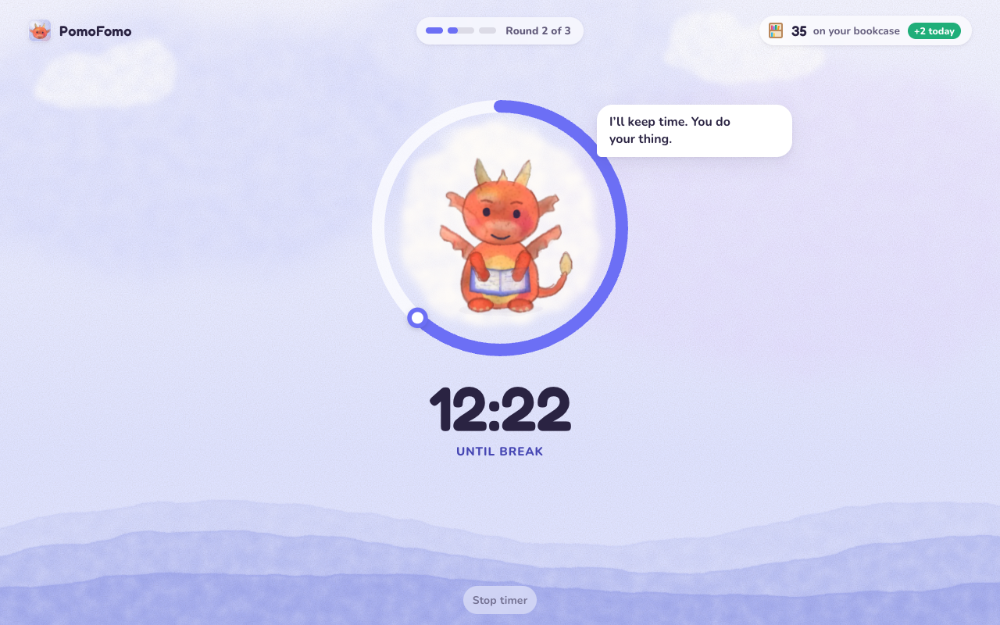
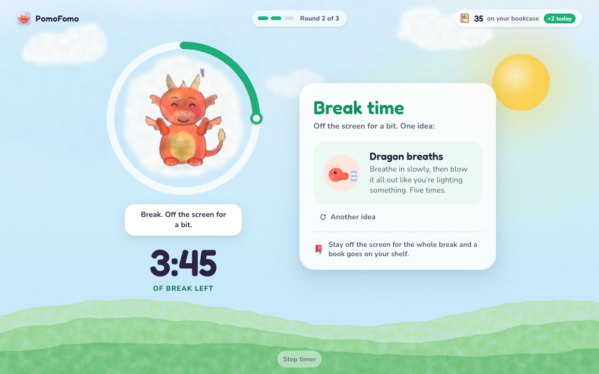
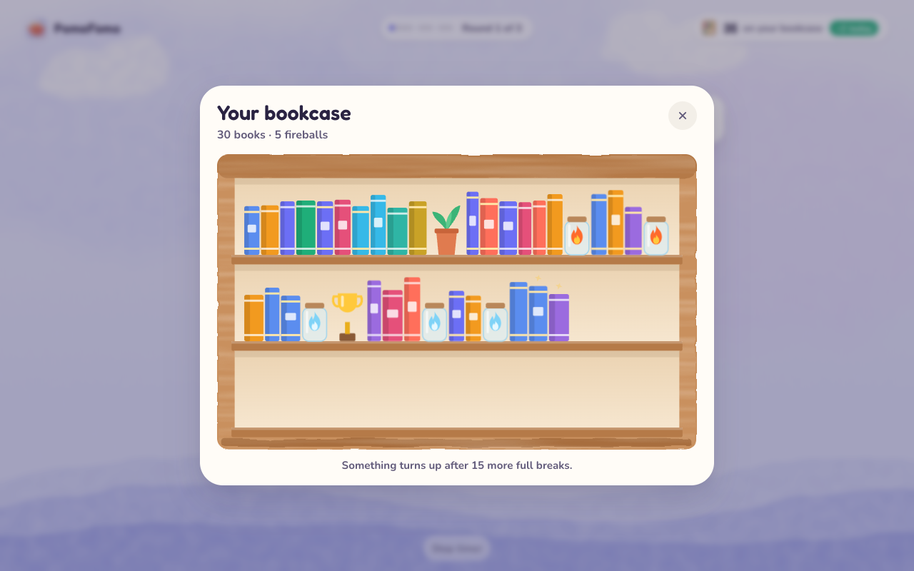

# PomoFomo

A break timer for kids, as a Chrome extension. It runs focus rounds and breaks (the Pomodoro technique), but its real job is getting kids off the screen when break time comes, and keeping them off until it's over.

**[Install PomoFomo from the Chrome Web Store](https://chromewebstore.google.com/detail/bckikfgjoglmobfdobabgbfidbdfhddm)**



## How it works

PomoFomo keeps a pinned timer tab open. A timer buddy sits in a watercolour landscape that changes with each part of the round:

- **Focus:** the buddy settles in and the ring counts down.
- **Two minutes left:** a quiet heads-up and a notification, so there's time to find a good place to stop. One "5 more minutes" per round.
- **Break:** the timer tab comes to the front with an idea for something to do away from the screen.
- **Back to it:** the next round starts on its own. After a few rounds comes a long break.



## The bookcase

Stay off the screen for the whole break and something goes on your bookcase. It never empties, adds a shelf when one fills up, and picks up a few surprises along the way. Switch to another tab mid-break and you get one reminder, and no book that time.



## Timer buddies

- **Ember**, a dragon who reads
- **Page**, a book in reading glasses
- **Yumyumnia**, an elf wizard who collects fireballs
- One more, if you know where to look

## For parents

The toolbar button opens a small control panel: pause, skip and stop, the focus and break lengths, a weekly view of rounds and full breaks, and a couple of options (bring the timer tab back every 30 seconds during breaks; resume after Chrome restarts).

## Privacy

No ads, no accounts, no analytics, no network requests. Everything stays in Chrome on your computer; settings follow Chrome sync if it's on. See the [privacy policy](https://reticulating-splines.github.io/PomoFomo/privacy-policy.html).

## Development

There's no build step: in `chrome://extensions`, turn on Developer mode, click **Load unpacked** and choose this folder.

Node is used only for the dev tools:

```bash
npm install          # once: installs puppeteer and a test copy of Chrome
npm test             # end-to-end test in headless Chrome
npm run release      # builds dist/PomoFomo-<version>.zip and tests the unzipped copy
npm run store        # regenerates the Web Store screenshots, icon and promo tiles
```

[PLAN.md](PLAN.md) describes the architecture, state, characters and visual design.
